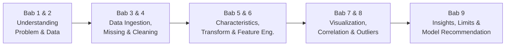
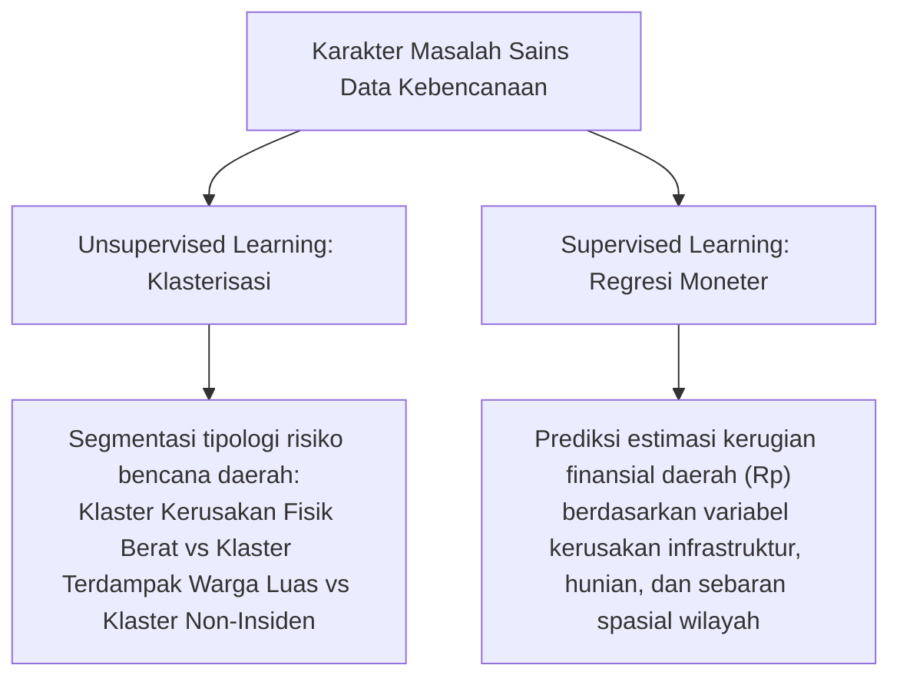
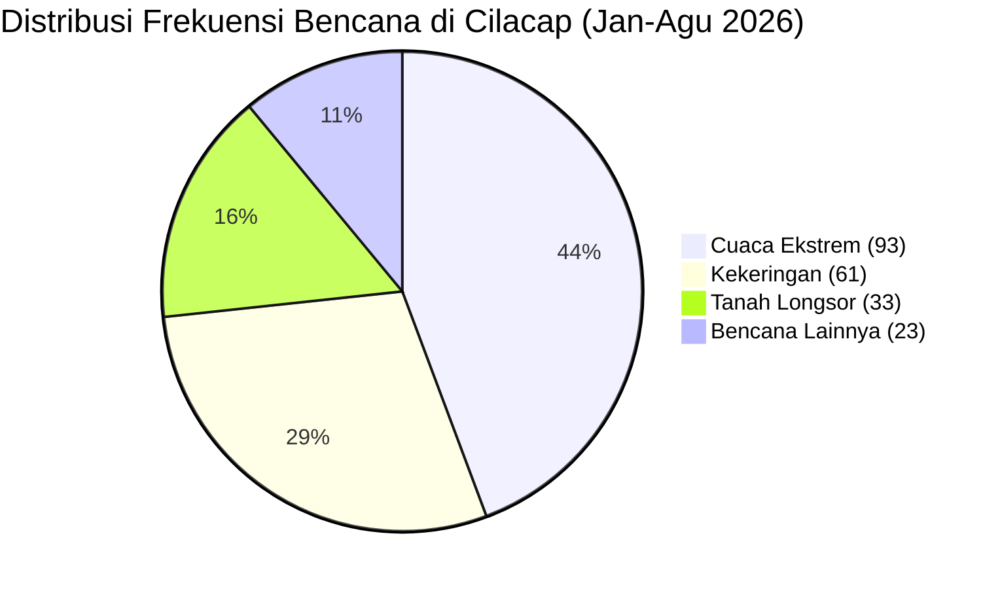
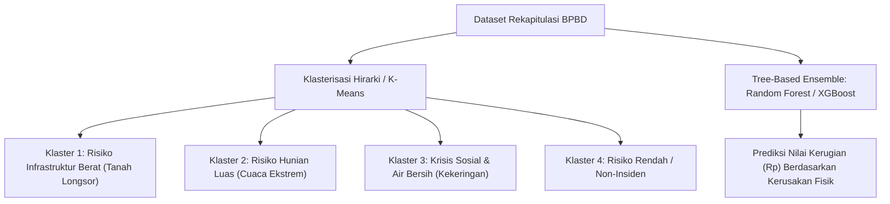

# LAPORAN LENGKAP EXPLORATORY DATA ANALYSIS (EDA)
## Rekapitulasi Kejadian dan Dampak Bencana di Kabupaten Cilacap Periode Januari – Agustus 2026
**Mata Kuliah:** Data Science (PSIKS2W002)  
**Program Studi:** Program Magister (S2) Ilmu Komputer, Universitas Amikom Purwokerto  
**Dosen Pengampu:** Giat Karyono, M.Kom.  
**Penyusun:** Yunita Narstyarini (NIM: 26MA41D016)  
**Standar Metodologi:** CRISP-DM / TDSP Framework & Silabus Kuliah Minggu 1–5  

---



---

## Bab 1: Pendahuluan & Memahami Masalah (Understanding the Problem)

### 1.1 Latar Belakang Masalah dan Tujuan Utama
Kabupaten Cilacap merupakan kabupaten terluas di Provinsi Jawa Tengah dengan topografi dan bentang alam yang sangat beragam: dataran rendah pesisir Samudra Hindia di wilayah selatan, dataran rawa dan estuari Segara Anakan, serta kawasan perbukitan terjal dan patahan geologis di wilayah barat laut dan tengah (Kecamatan Karangpucung, Majenang, Dayeuhluhur, Cimanggu). Karakteristik bentang geografis ini menempatkan Cilacap sebagai salah satu wilayah "supermarket bencana" dengan kerentanan hidrometeorologi (cuaca ekstrem, kekeringan, longsor, karhutla) dan geologis yang sangat tinggi.

Berdasarkan data resmi rekapitulasi Badan Penanggulangan Bencana Daerah (BPBD) Kabupaten Cilacap untuk keadaan bulan **Januari hingga Agustus 2026**, tercatat:
- Total akumulasi kejadian: **210 kali bencana**.
- Total warga terdampak: **44.591 jiwa** (dari 15.775 KK).
- Total kerusakan hunian: **901 unit rumah** (roboh, rusak berat, sedang, dan ringan).
- Total kerugian finansial terdata: **Rp3.114.675.000**.

> [!IMPORTANT]
> **Objektif Bisnis / Domain:**
> Badan Penanggulangan Bencana Daerah (BPBD) dan Pemerintah Kabupaten Cilacap membutuhkan landasan berbasis data (*data-driven decision making*) untuk mengoptimalkan alokasi Anggaran Belanja Tidak Terduga (BTT), memetakan skala prioritas penanganan logistik darurat, serta merancang mitigasi struktural dan non-struktural jangka panjang.

**Tujuan Utama Analisis:**
1. Mengidentifikasi struktur frekuensi kejadian, dampak sosial (warga terdampak dan pengungsi), dan kerusakan fisik per jenis bencana.
2. Mengeksplorasi disparitas antara intensitas frekuensi bencana terhadap besaran kerugian moneter riil.
3. Menemukan anomali administratif, korelasi antarvariabel dampak, dan karakteristik distribusi data sebagai input pra-pemrosesan model prediksi kebencanaan.

### 1.2 Tipe Masalah
Dalam taksonomi sains data modern, permasalahan analisis data rekapitulasi kebencanaan ini dipetakan ke dalam dua pendekatan:



1. **Klasterisasi (Unsupervised Learning - Problem Primer):** Mengelompokkan jenis ancaman bencana berdasarkan profil multivariat tingkat keparahan dampaknya (apakah tergolong bencana *high frequency - low impact*, *low frequency - high impact*, atau *mass human impact*).
2. **Regresi (Supervised Learning - Problem Sekunder):** Mengestimasi nilai kerugian moneter ($\text{Loss}$ dalam rupiah) sebagai variabel kontinu target terhadap fitur prediktor kerusakan infrastruktur jalan, hunian, dan cakupan wilayah terdampak.

### 1.3 Metrik Keberhasilan
Sesuai prinsip enterprise data science (Materi Minggu 1: siklus TDSP/CRISP-DM), metrik keberhasilan dibagi menjadi dua horizon:

| Horizon Proyek | Metrik Evaluasi | Target Kriteria Sukses |
| :--- | :--- | :--- |
| **Tahap EDA & Data Preparation** | Integritas & Kualitas Data | 100% missing values terpetakan mekanismenya (MNAR/MCAR), eliminasi duplikasi baris, normalisasi format nominal mata uang, perbaikan pergeseran kolom tabular. |
| **Tahap Klasterisasi Lanjutan** | Silhouette Coefficient ($S$) & Davies-Bouldin Index ($DBI$) | $S > 0{,}50$ (pemisahan klaster padat dan tegas) dan $DBI < 0{,}80$. |
| **Tahap Regresi Finansial Lanjutan** | Mean Absolute Error (MAE) & $R^2$ Score | $\text{MAE} \le \text{Rp } 150.000.000$ dan $R^2 \ge 0{,}85$ pada evaluasi validasi silang (cross-validation). |

---

## Bab 2: Memahami Data (Understanding the Data)

### 2.1 Pengumpulan Data (Data Collection)
- **Sumber Data:** Data sekunder administratif resmi bersumber dari Laporan Rekapitulasi Kejadian dan Bencana BPBD Kabupaten Cilacap Tahun 2026 (Periode Bulan Januari – Agustus 2026).
- **Proses Ekstraksi Data:** Lembar dokumen laporan tabular bersumber dari arsip rekapitulasi BPBD diekstraksi ke format file Comma-Separated Values (`dataset_bencana_cilacap_2026.csv`) dengan penataan 39 kolom terstruktur menggunakan encoding UTF-8.

### 2.2 Deskripsi dan Eksplorasi Awal Data
Dataset mentah mencakup 15 baris kategori bencana standar BNPB/BPBD dan 39 kolom atribut:

```
[Kategori Identitas]
- Jenis_Bencana

[Cakupan Wilayah & Insiden]
- Kejadian, Kecamatan_Terdampak, Desa_Kelurahan_Terdampak

[Dampak Korban Jiwa]
- Meninggal_Dunia, Luka_Berat, Luka_Ringan

[Dampak Kerusakan Hunian]
- Rumah_Roboh_Musnah, Rumah_Rusak_Berat, Rumah_Rusak_Sedang, Rumah_Rusak_Ringan, Rumah_Terendam_KK, Rumah_Terancam

[Dampak Kerusakan Infrastruktur & Fasilitas Umum (17 Fitur)]
- Infra_Sekolah, Infra_Jln_Nas, Infra_Jln_Prov, Infra_Jln_Kab, Infra_Jln_Desa, Infra_Tebing, Infra_Sawah, Infra_Turap_Talud, Infra_Tanggul, Infra_Saluran_Air, Infra_Lahan_Terbakar, Infra_Pabrik, Infra_Pasar, Infra_Tempat_Usaha, Infra_Jembatan, Infra_Tempat_Ibadah, Infra_Fasum_Lainnya

[Dampak Penduduk & Sosial]
- Warga_Terdampak_Jiwa, Warga_Terdampak_KK, Warga_Terdampak_L, Warga_Terdampak_P
- Pengungsi_Jiwa, Pengungsi_KK, Pengungsi_L, Pengungsi_P

[Dampak Kerugian Ekonomi]
- Jumlah_Kerugian (Rupiah)
```

### 2.3 Peninjauan Kualitas Data (Data Quality Assessment)
Hasil evaluasi komprehensif terhadap kualitas data awal mendeteksi 4 anomali penting:

1. **Penulisan Nilai Kosong Berupa Simbol Strip (`'-'`):** BPBD mencatat nihilnya kejadian bencana pada suatu kategori dengan tanda strip bukan angka `0`. Karakter ini menyebabkan seluruh kolom numerik dibaca oleh engine pandas sebagai tipe `object` (string).
2. **Duplikasi Entri Kategori Bencana:** Kategori `'KEKERINGAN'` muncul 2 kali, yaitu pada baris ke-4 (berisi data aktif 61 kejadian) dan baris ke-7 (seluruh kolom bernilai `'-'`). Ini merupakan kesalahan input saat kompilasi laporan BPBD.
3. **Anomali Skala Nilai Ekstrem (Pencilan Luar Biasa):** Variabel `Warga_Terdampak_Jiwa` pada bencana Kekeringan melonjak hingga **41.332 jiwa** (92,7% dari total seluruh bencana di kabupaten), menciptakan skewness ekstrem.
4. **Format Moneter Campuran:** Kolom `Jumlah_Kerugian` memuat teks awalan `'Rp'` serta tanda titik pemisah ribuan (contoh: `'Rp1.550.900.000'`), yang wajib dibersihkan agar dapat dioperasikan secara matematis.
5. **Pergeseran Kolom (*Column Offset Glitch*):** Pada skrip ekstraksi awal, kolom fasilitas peribadatan (`Infra_Tempat_Ibadah`) sempat terlewat dalam array nama kolom sehingga data nominal kerugian bergeser ke luar rentang kolom. Masalah ini telah dikoreksi dengan menetapkan 39 skema atribut penuh.

### 2.4 Eksplorasi Visual Awal
Eksplorasi awal memperlihatkan konsentrasi bencana yang sangat timpang (*high concentration*). Dari 15 kategori bencana yang dipantau, sebanyak 8 kategori (Banjir, Gelombang Pasang, Gempa Bumi, Tsunami, Erupsi Gunung Api, Epidemi/Wabah, Gagal Teknologi, Konflik Sosial) tercatat bernilai 0 insiden pada kurun Januari–Agustus 2026. Bencana didominasi secara mutlak oleh 3 ancaman hidrometeorologi: **Cuaca Ekstrem (93 kejadian)**, **Kekeringan (61 kejadian)**, dan **Tanah Longsor (33 kejadian)**.

### 2.5 Penyelarasan dengan Kebutuhan Bisnis (Business-Data Alignment)
- **Asesmen Nilai Data:** Dataset rekapitulasi agregat ini memiliki nilai strategis tinggi untuk perencanaan makro APBD/BTT tingkat kabupaten dan evaluasi alokasi peralatan darurat.
- **Kebutuhan Data Tambahan:** Untuk pemodelan prediktif tingkat mikro/operasional, data ini perlu diperkaya dengan data deret waktu harian (*daily event log*), data curah hujan BMKG (*satellite precipitation data*), serta data elevasi/kemiringan lereng per desa (*Digital Elevation Model / DEM*).

---

## Bab 3: Memuat & Memeriksa Data (Importing and Inspecting the Data)

### 3.1 Import Library dan Loading Dataset
Analisis EDA dilakukan menggunakan Python dengan pustaka ilmiah standar:
- `pandas` (v2.x) dan `numpy`: Manipulasi tabel multidimensi, manipulasi string vektor, dan komputasi aljabar linear.
- `matplotlib.pyplot` dan `seaborn`: Visualisasi distribusi, korelasi, dan visualisasi statistik.
- `sklearn.preprocessing`: Normalisasi fitur (`MinMaxScaler`, `StandardScaler`).

Pemuatan berkas CSV:
```python
import pandas as pd
import numpy as np
import matplotlib.pyplot as plt
import seaborn as sns
from sklearn.preprocessing import MinMaxScaler

# Memuat dataset
df_raw = pd.read_csv('dataset_bencana_cilacap_2026.csv')
```

### 3.2 Inspeksi Dimensi dan Struktur Data
Pemeriksaan dimensi data mentah:
```python
print("Dimensi dataset awal:", df_raw.shape)  # Output: (15, 39)
```
Dataset terdiri dari 15 baris pengamatan (kategori bencana) dan 39 kolom atribut.

### 3.3 Pemeriksaan Tipe Data dan Informasi Umum
Hasil inspeksi `df_raw.info()` menunjukkan 38 kolom bertipe `object` karena keberadaan tanda `'-'` dan simbol `'Rp'`. Hanya kolom `Jenis_Bencana` yang seharusnya berstatus tipe teks (`string`/`object`), sedangkan 38 kolom lainnya merupakan metrik kuantitatif (*discrete count* atau *continuous monetary*).

### 3.4 Ringkasan Statistik Awal (Summary Statistics)
Pada data mentah sebelum pembersihan, ringkasan matematis melalui `df_raw.describe()` tidak dapat memunculkan ringkasan numerik karena seluruh nilai berstatus teks. Hal ini mengonfirmasi pentingnya tahap *Data Cleaning* dan *Handling Missing Data* pada Bab 4.

---

## Bab 4: Penanganan Data yang Hilang & Duplikat (Handling Missing Data)

### 4.1 Identifikasi dan Visualisasi Nilai yang Hilang
Simbol strip (`'-'`) dikonversi menjadi representasi standar `np.nan`:
```python
df = df_raw.replace('-', np.nan)
```
Sebanyak 8 baris memiliki nilai `NaN` di seluruh 38 kolom numerik, yang mencerminkan kategori bencana yang sama sekali tidak terjadi selama periode 8 bulan pencatatan.

### 4.2 Analisis Mekanisme Missing Data
Berdasarkan taksonomi statistik Little & Rubin:
- **MCAR (Missing Completely at Random):** Data hilang akibat galat acak sensor.
- **MAR (Missing at Random):** Data hilang tergantung pada variabel lain yang teramati.
- **MNAR (Missing Not at Random):** Data hilang karena mekanisme intrinsik dari nilai itu sendiri.

> [!NOTE]
> Pada dataset BPBD Cilacap ini, ketiadaan data diklasifikasikan sebagai **Missing Not at Random (MNAR) secara Administratif**. Tanda `'-'` bukan disebabkan oleh kelalaian surveyor atau rusaknya kuesioner, melainkan menandakan bahwa frekuensi insiden bencana tersebut pada kenyataannya memang **nol**.

### 4.3 Strategi Eliminasi (Deletions)
Pengecekan frekuensi kategori:
```python
df['Jenis_Bencana'].value_counts()
```
Ditemukan bahwa `'KEKERINGAN'` muncul dua kali. Baris ke-7 dihapus:
```python
# Eliminasi duplikasi baris KEKERINGAN kosong pada indeks 6
df = df.drop(index=6).reset_index(drop=True)
```
Setelah eliminasi, ukuran dataset menjadi **14 baris data unik valid** ($N = 14$).

### 4.4 Strategi Imputasi (Imputation Methods)
Karena tanda `'-'` adalah indikator ketiadaan kejadian, metode imputasi rata-rata (*mean imputation*) atau KNN Imputer **tidak boleh digunakan** karena akan membiaskan fakta sejarah bahwa tsunami atau erupsi gunung api memang tidak terjadi di Cilacap pada periode tersebut.

Penerapan imputasi deterministik:
```python
# Pembersihan teks mata uang
df['Jumlah_Kerugian'] = (
    df['Jumlah_Kerugian'].astype(str)
    .str.replace('Rp', '', regex=False)
    .str.replace('.', '', regex=False)
    .astype(float)
)

# Imputasi nilai 0 untuk seluruh metrik numerik
num_cols = [c for c in df.columns if c != 'Jenis_Bencana']
for col in num_cols:
    df[col] = pd.to_numeric(df[col], errors='coerce').fillna(0)
```

---

## Bab 5: Eksplorasi Karakteristik Data (Exploring Data Characteristics)

### 5.1 Analisis Statistik Deskriptif untuk Data Numerik
Ringkasan statistik kuantitatif untuk 5 variabel kunci setelah pembersihan ($N = 14$):

| Variabel Metrik | Total Kumulatif | Mean ($\mu$) | Median ($Q_2$) | Std. Deviasi ($\sigma$) | Min | Q1 | Q3 | IQR | Max |
| :--- | :--- | :--- | :--- | :--- | :--- | :--- | :--- | :--- | :--- |
| **Jumlah Kejadian** | 210 kali | 15,00 | 0,00 | 28,41 | 0 | 0,00 | 9,00 | 9,00 | 93 (Cuaca Ekstrem) |
| **Total Rumah Rusak** | 901 unit | 64,36 | 0,00 | 231,71 | 0 | 0,00 | 1,00 | 1,00 | 869 (Cuaca Ekstrem) |
| **Rumah Rusak Ringan** | 810 unit | 57,86 | 0,00 | 214,19 | 0 | 0,00 | 0,00 | 0,00 | 802 (Cuaca Ekstrem) |
| **Warga Terdampak (Jiwa)**| 44.591 jiwa | 3.185,07 | 0,00 | 11.002,17 | 0 | 0,00 | 214,00 | 214,00 | 41.332 (Kekeringan) |
| **Kerugian Materiil (Rp)**| Rp3,11 Miliar | Rp222.476.786 | Rp0 | Rp537.397.891 | Rp0 | Rp0 | Rp20.000.000 | Rp20.000.000 | Rp1,55 M (Tnh Longsor) |

> [!TIP]
> **Interpretasi Perbedaan Mean vs Median:**
> Pada seluruh variabel di atas, nilai **Mean jauh melampaui nilai Median** ($\text{Mean} \gg \text{Median} = 0$). Hal ini mencerminkan fenomena *zero-inflated data*, di mana lebih dari 50% data observasi bernilai nol dan sebagian kecil nilai positif bernilai masif.

### 5.2 Analisis Bentuk Distribusi Data (Skewness dan Kurtosis)

Secara matematis, Skewness ($g_1$) dan Excess Kurtosis ($g_2$) dihitung berdasarkan momen ketiga dan keempat:

$$g_1 = \frac{n}{(n-1)(n-2)} \sum_{i=1}^n \left(\frac{x_i - \bar{x}}{s}\right)^3$$

$$g_2 = \frac{n(n+1)}{(n-1)(n-2)(n-3)} \sum_{i=1}^n \left(\frac{x_i - \bar{x}}{s}\right)^4 - \frac{3(n-1)^2}{(n-2)(n-3)}$$

Hasil perhitungan nilai bentuk distribusi data:

| Variabel | Skewness ($g_1$) | Klasifikasi Kemiringan | Excess Kurtosis ($g_2$) | Bentuk Kurva |
| :--- | :--- | :--- | :--- | :--- |
| **Jumlah Kejadian** | **+2,151** | *Highly Positively Skewed* | **+4,055** | Leptokurtik (Puncak Tajam) |
| **Kerugian Materiil** | **+2,289** | *Highly Positively Skewed* | **+3,824** | Leptokurtik (Puncak Tajam) |
| **Total Rumah Rusak** | **+3,735** | *Extremely Skewed* | **+13,964** | Ekstrem Leptokurtik |
| **Warga Terdampak** | **+3,716** | *Extremely Skewed* | **+13,855** | Ekstrem Leptokurtik |
| **Rumah Rusak Ringan** | **+3,741** | *Extremely Skewed* | **+13,997** | Ekstrem Leptokurtik |

**Implikasi Statistik:**
1. Nilai skewness positif yang besar ($g_1 > +2$) menunjukkan bahwa ekor distribusi menjulur panjang ke sisi kanan (*right-skewed tail*).
2. Nilai kurtosis yang jauh lebih besar dari nol ($g_2 \gg 0$) menandakan bahwa data bersifat **Leptokurtik** dengan *fat tails* (probabilitas munculnya kejadian ekstrem jauh lebih tinggi daripada kurva normal Gaussian standar).
3. **Konsekuensi:** Asumsi parametrik Gauss dilanggar, sehingga uji korelasi Pearson dan model linier klasik Ordinary Least Squares (OLS) tidak valid tanpa transformasi fitur.

---

## Bab 6: Transformasi Data & Rekayasa Fitur (Data Transformation & Feature Engineering)

### 6.1 Transformasi untuk Memperbaiki Distribusi (Handling Skewness)
Untuk menstabilkan varians dan merapatkan ekor kanan tanpa menyebabkan kegagalan matematis pada nilai nol ($\log 0 = -\infty$), diterapkan **Logarithmic Transformation** dengan fungsi:

$$y = \log_e(1 + x) = \text{np.log1p}(x)$$

Hasil perbandingan rentang skala:
- $\text{Jumlah\_Kerugian}$ mentah: $[0 \text{ hingga } 1.550.900.000]$ $\rightarrow$ Rentang Log: $[0 \text{ hingga } 21{,}16]$.
- $\text{Warga\_Terdampak}$ mentah: $[0 \text{ hingga } 41.332]$ $\rightarrow$ Rentang Log: $[0 \text{ hingga } 10{,}63]$.

Transformasi ini secara substansial menekan heteroskedastisitas dan menyamakan dispersi nilai.

### 6.2 Transformasi Skala (Scaling & Normalization)
Untuk kebutuhan algoritma klasterisasi berbasis jarak Euclid seperti *K-Means* atau *Hierarchical Agglomerative Clustering*, perbedaan satuan antara Rupiah (miliaran) dan Kejadian (satuan) akan mendominasi fungsi jarak:

$$d(p, q) = \sqrt{\sum_{i=1}^n (p_i - q_i)^2}$$

Oleh karena itu, diterapkan **MinMaxScaler** ke dalam rentang tertutup $[0, 1]$:

$$x_{\text{scaled}} = \frac{x - x_{\min}}{x_{\max} - x_{\min}}$$

Variabel seperti Kejadian (maksimum 93) dan Kerugian (maksimum Rp1,55 Miliar) kini memiliki bobot proporsional seimbang $[0, 1]$.

### 6.3 Konversi Data Kategorikal (Categorical Encoding)
Variabel `Jenis_Bencana` adalah variabel nominal tanpa tingkatan hierarki. Pada pipeline machine learning, fitur ini dikonversi menggunakan **One-Hot Encoding** menjadi 14 kolom vektor ortogonal biner $\{0, 1\}$.

### 6.4 Pembuatan Fitur Baru (Feature Engineering)
Tiga fitur baru berhasil direkayasa untuk menghasilkan indikator resiko yang lebih tajam:

```python
# 1. Kerugian rata-rata per insiden
df['Kerugian_Per_Kejadian'] = np.where(df['Kejadian'] > 0, df['Jumlah_Kerugian'] / df['Kejadian'], 0)

# 2. Total kerusakan fisik hunian
df['Total_Rumah_Rusak'] = (
    df['Rumah_Roboh_Musnah'] + df['Rumah_Rusak_Berat'] + 
    df['Rumah_Rusak_Sedang'] + df['Rumah_Rusak_Ringan']
)

# 3. Rasio dampak warga per kejadian
df['Warga_Per_Kejadian'] = np.where(df['Kejadian'] > 0, df['Warga_Terdampak_Jiwa'] / df['Kejadian'], 0)
```

Ringkasan Hasil Fitur Rekayasa pada Bencana Aktif:

| Jenis Bencana | Frekuensi Kejadian | Total Rumah Rusak | Kerugian Total (Rp) | Kerugian / Kejadian (Daya Rusak Ekonomi) | Warga / Kejadian (Daya Rusak Sosial) |
| :--- | :--- | :--- | :--- | :--- | :--- |
| **Tanah Longsor** | 33 kali | 28 unit | Rp1.550.900.000 | **Rp46.996.970 / kejadian** | 2,21 jiwa / kejadian |
| **Cuaca Ekstrem** | 93 kali | 869 unit | Rp1.423.925.000 | **Rp15.311.022 / kejadian** | 28,81 jiwa / kejadian |
| **Kejadian Lainnya** | 9 kali | 3 unit | Rp118.500.000 | **Rp13.166.667 / kejadian** | 0,67 jiwa / kejadian |
| **Kebakaran Gedung** | 6 kali | 1 unit | Rp20.000.000 | **Rp3.333.333 / kejadian** | 47,83 jiwa / kejadian |
| **Karhutla** | 8 kali | 0 unit | Rp1.350.000 | **Rp168.750 / kejadian** | 26,75 jiwa / kejadian |
| **Kekeringan** | 61 kali | 0 unit | Rp0 | **Rp0 / kejadian** | **677,57 jiwa / kejadian** |

---

## Bab 7: Visualisasi Hubungan Data (Visualizing Relationship of Data)

### 7.1 Analisis Distribusi Variabel Tunggal (Univariate Analysis)
Visualisasi frekuensi kejadian dan perbandingan kerugian moneter:

```
[Distribusi Frekuensi Kejadian Bencana di Kabupaten Cilacap 2026]
Cuaca Ekstrem      |=============================================| 93 kali (44,3%)
Kekeringan         |=============================| 61 kali (29,0%)
Tanah Longsor      |================| 33 kali (15,7%)
Kejadian Lainnya   |====| 9 kali (4,3%)
Karhutla           |===| 8 kali (3,8%)
Kebakaran Gedung   |==| 6 kali (2,9%)
8 Kategori Lainnya | 0 kali (0,0%)

[Proporsi Kerugian Finansial Menurut Jenis Bencana]
Tanah Longsor      |====================================| Rp1.550,9 Juta (49,8%)
Cuaca Ekstrem      |=================================| Rp1.423,9 Juta (45,7%)
Kejadian Lainnya   |==| Rp118,5 Juta (3,8%)
Kebakaran Gedung   | Rp20,0 Juta (0,6%)
Karhutla           | Rp1,35 Juta (0,04%)
Kekeringan         | Rp0 (0,0%)
```

### 7.2 Analisis Hubungan Antar Variabel (Bivariate Analysis)
Eksplorasi hubungan antarvariabel mengungkap relasi **non-linearitas** yang tajam:
1. **Kejadian vs Kerusakan Hunian:** Cuaca Ekstrem mencatat 93 kejadian dan merusak 869 rumah. Sebagian besar berupa kerusakan atap/genteng akibat angin kencang (802 unit rusak ringan). Sebaliknya, Tanah Longsor hanya mencatat 8 unit rusak ringan, namun merusak berat 2 unit dan mengancam 32 unit rumah lainnya.
2. **Kejadian vs Kerugian Finansial:** Walaupun Cuaca Ekstrem frekuensinya hampir 3 kali lipat Tanah Longsor, nilai kerugian Tanah Longsor justru lebih tinggi (Rp1,55 Miliar vs Rp1,42 Miliar). Penjelasan domain: Tanah Longsor menghancurkan infrastruktur berbiaya tinggi (14 titik jalan kabupaten, 6 titik jalan provinsi, 8 talud, 6 tebing jalan, dan 2 jembatan).

### 7.3 Analisis Korelasi dan Asosiasi
Karena data memiliki skewness ekstrem dan non-parametrik, digunakan **Matriks Korelasi Peringkat Spearman ($\rho$)**:

$$\rho = 1 - \frac{6 \sum d_i^2}{n(n^2 - 1)}$$

```
          [Matriks Korelasi Spearman Antar Variabel Kunci]
                             Kejadian  Kecamatan  TotRumah  Warga  Kerugian
Kejadian                       1.00      0.99      0.79     0.86    0.84
Kecamatan_Terdampak            0.99      1.00      0.79     0.87    0.83
Total_Rumah_Rusak              0.79      0.79      1.00     0.68    0.88
Warga_Terdampak_Jiwa           0.86      0.87      0.68     1.00    0.69
Jumlah_Kerugian                0.84      0.83      0.88     0.69    1.00
```

**Temuan Korelasi Utama:**
- Korelasi tertinggi ($\rho = 0{,}88$) terjadi antara **Total Rumah Rusak** dan **Jumlah Kerugian**, membuktikan bahwa kerusakan aset fisik bangunan merupakan pemicu utama besaran kerugian moneter BPBD.
- Korelasi antara **Warga Terdampak** dan **Jumlah Kerugian** relatif lebih rendah ($\rho = 0{,}69$). Hal ini disebabkan oleh fenomena bencana Kekeringan yang memiliki 41.332 warga terdampak namun kerugian finansialnya dicatat Rp0.

---

## Bab 8: Penanganan Pencilan (Handling Outliers)

### 8.1 Metode Deteksi Pencilan
Pendeteksian dilakukan menggunakan aturan pagar dalam **Interquartile Range (IQR)**:

$$\text{Batas Atas} = Q_3 + 1{,}5 \times \text{IQR}$$

$$\text{Batas Bawah} = Q_1 - 1{,}5 \times \text{IQR}$$

Hasil evaluasi batas atas IQR:
1. **Variabel Kejadian:** Batas Atas $= 9 + 1{,}5(9) = 22{,}5$.  
   *Pencilan Terdeteksi:* **Cuaca Ekstrem (93)** dan **Kekeringan (61)**, disusul **Tanah Longsor (33)**.
2. **Variabel Warga Terdampak:** Batas Atas $= 214 + 1{,}5(214) = 535$.  
   *Pencilan Terdeteksi:* **Kekeringan (41.332 jiwa)** dan **Cuaca Ekstrem (2.679 jiwa)**.
3. **Variabel Jumlah Kerugian:** Batas Atas $= 20.000.000 + 1{,}5(20.000.000) = \text{Rp } 50.000.000$.  
   *Pencilan Terdeteksi:* **Tanah Longsor (Rp1.550.900.000)**, **Cuaca Ekstrem (Rp1.423.925.000)**, dan **Kejadian Lainnya (Rp118.500.000)**.

### 8.2 Keputusan Perlakuan Terhadap Pencilan (Treatment Decisions)
Dalam literatur sains data, terdapat empat perlakuan umum terhadap outliers:
- *Trimming / Dropping* (Membuang baris)
- *Winsorization / Capping* (Memotong nilai batas)
- *Transformation* (Mengubah skala log)
- *Retention* (Mempertahankan nilai asli)

> [!CAUTION]
> **Keputusan Ilmiah & Domain Knowledge: RETENTION (Dipertahankan Penuh)**
> Seluruh pencilan pada dataset ini **TIDAK BOLEH DIHAPUS MAUPUN DITRUNCATE (NO DROPPING, NO WINSORIZING)**.
> 
> **Justifikasi:**
> Nilai-nilai ekstrem ini bukan merupakan galat entri data (*measurement error*), melainkan representasi bencana bencana nyata yang menjadi fokus operasi pertolongan dan pemulihan BPBD Kabupaten Cilacap. Jika pencilan 41.332 jiwa kekeringan dibuang, pembuat kebijakan akan gagal mengalokasikan armada mobil tangki air bersih. Oleh karena itu, strategi penanganan yang tepat adalah memitigasi distorsi algoritma melalui **Transformasi Logaritmik** dan pemilihan model machine learning non-parametrik yang tangguh terhadap pencilan (*robust to outliers*).

---

## Bab 9: Kesimpulan & Temuan Utama (Communicate Findings and Insights)

### 9.1 Rangkuman Temuan Utama (Key Insights & Patterns)



1. **Konsentrasi Risiko Hidrometeorologi (Pola Dominan):** Sebanyak **89,0%** (187 dari 210 kejadian) didominasi oleh tiga ancaman bencana: Cuaca Ekstrem, Kekeringan, dan Tanah Longsor.
2. **Disparitas Karakteristik Dampak (Anomali Menarik):**
   - **Kekeringan** mewakili **92,7% dampak kemanusiaan/sosial** (41.332 jiwa dari 44.591 total terdampak) serta merusak 77 titik lahan sawah pertanian, namun mencatat **Rp0 kerugian finansial langsung** pada format laporan BPBD.
   - **Tanah Longsor** memiliki frekuensi sedang (33 kali), namun memiliki **daya rusak ekonomi tertinggi** (Rp47,0 Juta per kejadian) akibat hancurnya 20 titik infrastruktur jalan kabupaten/provinsi dan 8 talud.
   - **Cuaca Ekstrem** menghasilkan volume **kerusakan hunian masif** (869 unit rumah) dan cakupan wilayah terluas (51 kecamatan-event dan 83 desa).
3. **Pola Konsentrasi Kerugian:** Sebanyak **95,5% dari total kerugian moneter kabupaten** (Rp2,97 Miliar dari total Rp3,11 Miliar) berasal dari akumulasi Cuaca Ekstrem dan Tanah Longsor.

### 9.2 Keterbatasan dan Kendala Analisis (Limitations & Constraints)
1. **Tingkat Agregasi Data (*Data Granularity*):** Dataset hanya menyajikan rekapitulasi 8 bulan tanpa variabel temporal harian/mingguan dan tanpa tabel relasional rincian nama kecamatan/desa secara spasial.
2. **Ketiadaan Valuasi Kerugian Pertanian:** Format laporan belum mengonversi kegagalan panen 77 titik lahan sawah pada bencana kekeringan ke dalam taksiran kerugian rupiah, sehingga nilai kerugian moneter mengalami *under-reporting*.
3. **Ukuran Sampel Kecil ($N = 14$ Kategori):** Pada tingkat agregasi kategori bencana, jumlah sampel terbatas untuk melatih model regresi berbasis deep learning, sehingga pendekatan terbaik adalah klasterisasi atau menunggu data granular log harian.

### 9.3 Rekomendasi Langkah Selanjutnya (Next Steps & Model Recommendations)



1. **Rekomendasi Algoritma Machine Learning:**
   - **Klasterisasi Risiko:** Menggunakan **Hierarchical Agglomerative Clustering (dengan Ward's Linkage)** atau **K-Medoids**. K-Medoids lebih unggul dibandingkan K-Means standar karena menghitung jarak dari titik data aktual (*medoids*) sehingga sangat kebal terhadap pencilan ekstrem.
   - **Prediksi Kerugian Moneter:** Jika dilakukan pada log insiden kejadian riil, direkomendasikan menggunakan algoritma *Tree-Based Ensemble* seperti **Random Forest Regressor** atau **XGBoost Regressor**. Model pohon tidak mengasumsikan distribusi normal Gauss, memiliki resistensi alami terhadap outliers, dan secara otomatis memodelkan interaksi non-linear antara kerusakan hunian dan infrastruktur jalan.
2. **Rekomendasi Rekayasa Data Lanjutan (*Data Engineering*):**
   - Mengembangkan pipeline integrasi otomatis data kejadian log per hari dan per kecamatan (*spatiotemporal pipeline*).
   - Memasukkan rumus valuasi kerugian sektor pertanian (*crop damage index*) untuk bencana kekeringan dan karhutla.
3. **Rekomendasi Kebijakan Mitigasi BPBD Cilacap:**
   - **Sektor Barat & Perbukitan:** Prioritas stabilisasi lereng, bronjong turap, dan relokasi rumah terancam longsor di wilayah Majenang-Karangpucung.
   - **Sektor Pesisir & Dataran:** Peningkatan ketahanan struktur atap rumah masyarakat menghadapi angin ribut / cuaca ekstrem, serta penguatan posko armada distribusi tangki air bersih di kantong-kantong kekeringan (seperti Kawunganten, Patimuan, Bantarsari).

---
*Dokumen Laporan Exploratory Data Analysis ini disusun secara lengkap dan sistematis untuk memenuhi standar evaluasi Proyek Sains Data Tingkat Magister (S2).*
